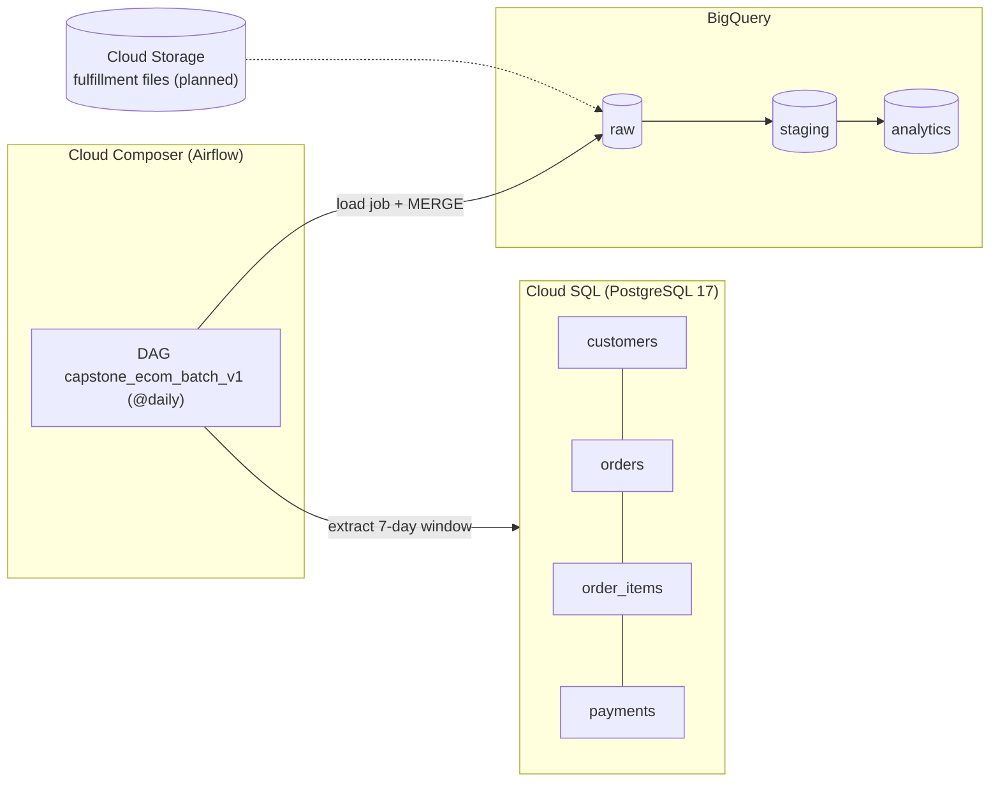

# E-commerce batch pipeline on GCP (Cloud SQL -> BigQuery, Airflow on Cloud Composer)

End-of-training data engineering project (Diginamic, Data Engineer program).
A daily, incremental and replayable batch pipeline that moves e-commerce data from an
operational PostgreSQL database to a BigQuery `raw` layer, orchestrated by Airflow on Cloud Composer.

## Architecture



`staging` and `analytics` datasets are created but not populated yet (see Limitations).

## What the DAG does

`dags/capstone_ecom_batch.py`

1. `create_raw_tables`: create the BigQuery raw tables if missing.
2. `simulate_oltp_activity`: insert one day of fake customers, orders, items and payments, and update some statuses (settled payments, cancelled orders). Timestamps derive from the run's logical date, never from `NOW()`, so backfills are reproducible.
3. `load_<table>_raw` (4 tasks, respecting foreign-key order): read rows whose `updated_at` falls in the last 7 days, load them into a temporary BigQuery table with a load job (no streaming), then `MERGE` into the raw table. Temporary tables are always dropped.
4. `bq_control_check`: log the row count of each raw table.

## Design choices

- **Incremental with a lookback window.** Each run re-reads 7 days to catch late updates. The `MERGE` keeps it idempotent.
- **No stale overwrite.** A row is only updated if the incoming `source_updated_at` is greater than or equal to the stored one, so replaying an old run cannot overwrite newer data.
- **Lineage columns.** `updated_at` becomes `source_updated_at`, and `ingested_at` records when the row landed in BigQuery.
- **Load job + MERGE instead of streaming inserts**: cheaper, atomic, and easy to retry (retries = 2).
- **Pure helpers split from the DAG** (`dags/ecom_common.py`, `dags/ecom_simulation.py`) so the logic is unit tested without Airflow.
- **Least-privilege service account** for Composer (BigQuery jobUser and dataEditor, Storage objectViewer, Cloud SQL client).

## Repository layout

```
dags/       Airflow DAG and pure Python helpers
sql/        OLTP schema (PostgreSQL)
scripts/    gcloud setup, one numbered script per step, configuration through environment variables
tests/      pytest unit tests (no GCP or Airflow needed)
outputs/    sample CSV extracts of the raw BigQuery tables after a few runs
```

## Run it

Requires a GCP project with billing enabled (Cloud SQL and Composer are not free; delete them when done).

```bash
cp scripts/00_env.example.sh scripts/env.local.sh   # fill in your values, never commit this file
export SQL_PASSWORD="$(openssl rand -base64 24)"    # or set it in env.local.sh
source scripts/env.local.sh
./scripts/01_project_and_iam.sh
./scripts/02_storage_bigquery.sh
./scripts/03_cloud_sql.sh
./scripts/04_composer.sh
```

Tests (a ready-to-use GitHub Actions workflow is in `docs/github-actions-tests.yml`, copy it to `.github/workflows/tests.yml`):

```bash
pip install -r requirements-dev.txt
pytest
```

## Limitations and next steps

- Only the `raw` layer is loaded. Next: `staging` (typing, deduplication) and `analytics` (daily revenue, conversion, payment success rate), ideally with dbt.
- Data is simulated, not a real shop.
- Secrets: the Airflow connection is created from an environment variable. Next: Secret Manager as Airflow secrets backend, and Cloud SQL private IP.
- Add data quality checks (row-count reconciliation between source and raw, not-null and uniqueness tests).
- Infrastructure as code (Terraform) instead of shell scripts.
